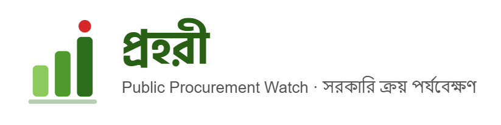
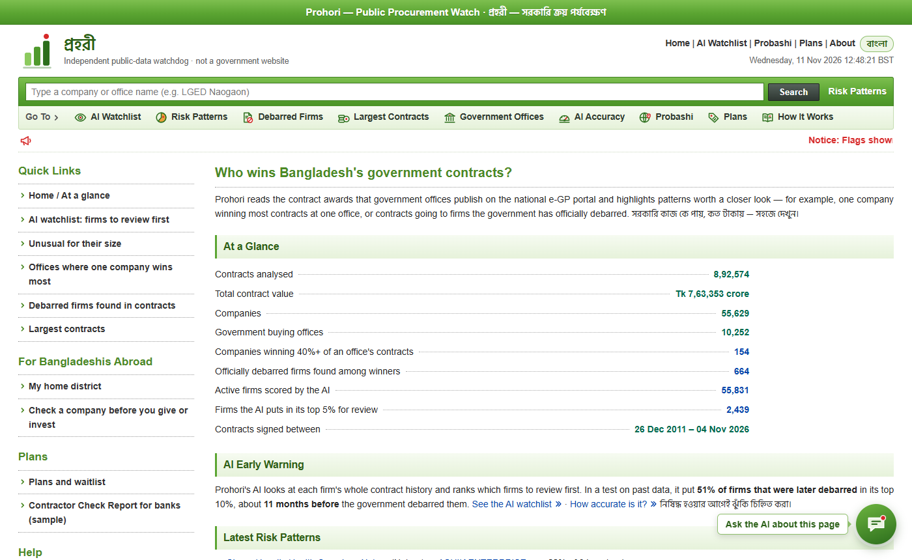
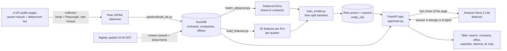
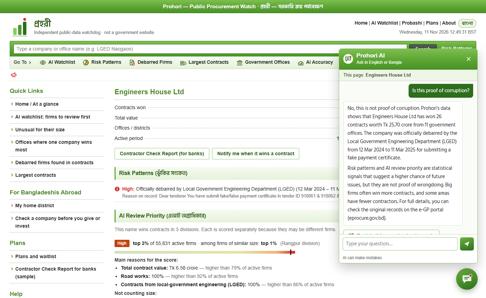
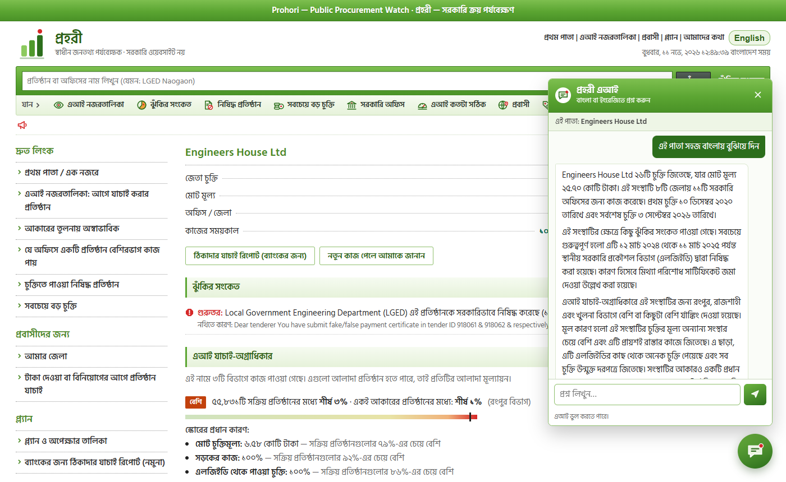
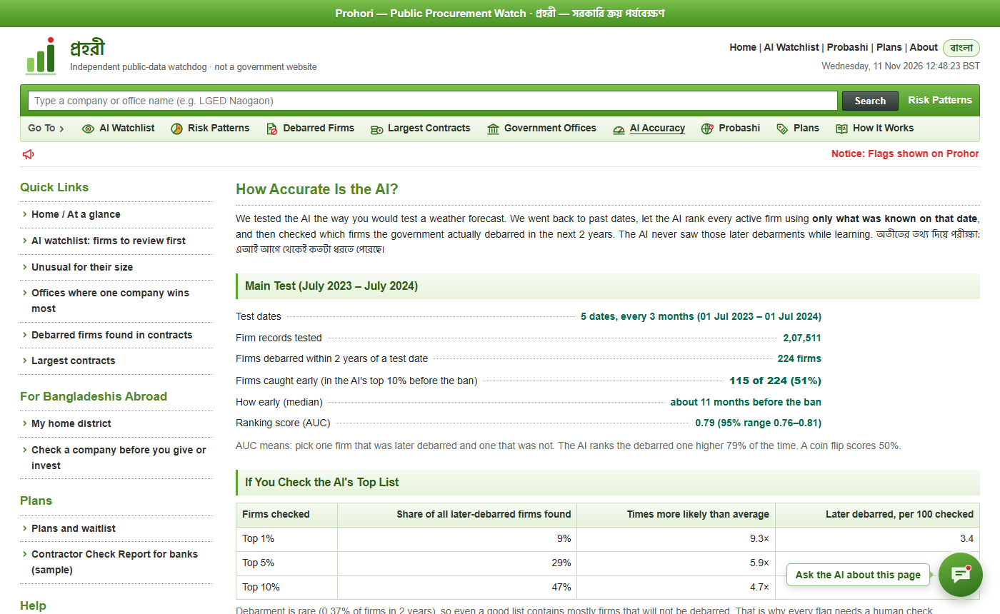

<p align="center">
  
</p>

# প্রহরী · Prohori — Public Procurement Watch

**An AI watchdog for Bangladesh's public procurement.** Prohori reads every contract award that government offices
publish on the national e-GP portal ([eprocure.gov.bd](https://www.eprocure.gov.bd)), ranks contractors for human
review with a tested machine-learning model, and explains every result in plain Bangla and English with an
AI assistant that only uses facts from the page.

**Live:** [prohori.safeshare.co](https://prohori.safeshare.co) · updated every night from e-GP

> Built for the **International AI Builders Congress 2026** · Idea to Unicorn · CivicSphere AI · *Transparent Government*.



## Why

- Government offices award roughly **1.2 lakh tenders a year**, worth about **Tk 1 lakh crore**. Every award is
  public on e-GP by law, but there are close to **9 lakh** of them. Nobody can review that many by hand.
- Transparency International Bangladesh found that the **top 5% of contractors won 61% of e-GP contract value**.
- AI watchdogs on procurement data already work elsewhere (Brazil's *ALICE*, Ukraine's *DOZORRO*).
  Prohori brings the idea to Bangladesh, on Bangladesh's own open data, in Bangla.

## What it does

| Feature | Status |
|---|---|
| Polite, resumable collection of every public award notice (Dec 2011 to today: **892,574 contracts**, Tk 7.6 lakh crore, 55,629 companies, 10,252 offices) and the government debarment list (1,030 records) |  |
| Cleaning, de-duplication and company-name matching (exact, joint-venture partners, near-exact); **92% of debarred names matched** to their contracts |  |
| Rule-based risk patterns: one company dominating an office, direct or single-source buying, officially debarred winners, shared-name warnings |  |
| **AI early-warning model** (logistic regression + monotone gradient boosting) with a time-split backtest against later debarments |  |
| AI watchlist (overall and "unusual for its size", by division), plain-language reasons for every score, public "How accurate is the AI?" page |  |
| **Prohori AI assistant** on every page (Amazon Nova 2 Lite on Bedrock): explains the page in simple Bangla or English, answers follow-up questions, refuses to accuse anyone |  |
| Full English / বাংলা switch for the whole site, phone-friendly layout |  |
| District pages for all 64 districts, a section for Bangladeshis living abroad, printable Contractor Check Report |  |
| **Live on AWS** with HTTPS and a nightly data update from e-GP |  |
| Bidding signals from ~28,000 contract detail pages (single bidder, late signing, shared addresses): tested, gave no extra accuracy, shown as facts only |  |

<sub> done ·  tested, not used in the score</sub>

## How it works



**Input → processing → output**

1. **Input.** Public, login-free e-GP pages: award notices (who won, from which office, how much, which buying
   method, when) and the debarment list (who was banned, by whom, why, from when).
2. **Processing.** Names are cleaned and matched. A firm is identified by its name **plus its division**, so firms
   that share a name in different parts of the country are scored separately. For every firm and every quarter,
   35 features are built from **only what was known on that date**: size, growth, number of offices and
   districts, buying methods, timing, how much one office depends on the firm, and type of work.
3. **Output.** A review priority for each active firm (top 1% Very high, top 5% High, top 15% Elevated), the
   three main reasons in plain words, its rank among firms of a similar size, and an AI explanation on request.

## The AI, in three parts

### 1. Risk model: who should be reviewed first

- **Question it answers:** "Will the government debar this firm within the next 24 months?" Debarment is the only
  official, public, dated label of contractor misconduct in Bangladesh, so it is what the model can be tested on.
- **Model choice:** a rank average of **logistic regression** and **monotone, shallow LightGBM**.
  Logistic regression gives readable weights. LightGBM catches non-linear effects. The monotone limits stop it from
  learning odd rules a reviewer could not explain. Deep learning was not used: with about 1,000 debarments, a
  simpler model is more stable and easier to explain.
- **Honest testing:** trained on quarterly snapshots from 2016–2020, tuned on 2021, tested on 2023–2024 dates the
  model never saw. A second, earlier test period checks that the result is stable.

### 2. Explanations: why a firm is ranked where it is

Every score comes with its main reasons ("Total contract value: Tk 6.58 crore — higher than 79% of active firms"),
a separate list of reasons **not counting size**, and the firm's rank among firms of a similar size. Size is the
strongest single signal, so the app always shows whether a firm stands out for reasons other than being big.

### 3. Prohori AI assistant: plain-language answers

- **Model choice:** Amazon **Nova 2 Lite** (Bedrock, us-east-1). It was tested for Bangla quality and gave clear,
  natural answers. Nova Micro was tested as a cheaper option. Nova 2 Sonic was tested for voice and did not
  understand Bangla speech, so the assistant is text only.
- **Grounding:** for each page the server builds a **fact sheet** (contracts, offices, debarments, risk score and
  reasons, model accuracy). The model may only use those facts. If something is not in the fact sheet, it says so.
- **Rules in the system prompt:** never call a firm or person corrupt; always say a risk signal is not proof; use
  simple Bangla with a fixed glossary; answer in the language of the question; refuse unrelated requests.
- **Cost and abuse control:** answers are cached; limits per visitor per hour and per day.

| Asked "Is this proof of corruption?" | Asked to explain the page in Bangla |
|---|---|
|  |  |

*Example firm: one already debarred by the government (LGED, 2024).*

## How well the AI works (tested on data it never saw)

| | Main test (Jul 2023 – Jul 2024) | Earlier period (Jul 2020 – Jul 2021) |
|---|---|---|
| Ranking score (AUC; 0.5 = coin flip) | **0.79** (95% range 0.76–0.81) | 0.75 (0.70–0.79) |
| Simple "bigger firms are riskier" rule | 0.78 | 0.76 |
| Ranking among firms of a similar size (AI vs size rule) | **0.70 vs 0.65** | **0.62 vs 0.58** |
| Later-debarred firms in the AI's top 10% before the ban | **51%** (115 of 224), about 11 months early | 49% (57 of 117), about 21 months early |
| Top 1% of the list: how much more likely than average to be debarred | **9.3×** | 4.6× |

**What this means in plain words**

- The AI finds about half of the firms that are later debarred, months before the ban.
- Overall it is only a little better than ranking firms by size. Its real gain is **among firms of a similar size**,
  where size alone cannot help. At the top 5% of the list, the size rule alone does slightly better
  (6.8× vs 5.9× in the main test). We show both.
- Debarment is rare (0.37% of firms in two years). Even on the top 5% list, about 98 in 100 firms are never
  debarred. **Scores rank firms for human review; they never decide anything.**



### What we tried that did not work

Signals from contract detail pages (single bidder, late contract signing, late performance security, foreign aid,
shared address with a debarred firm) were tested on a weighted random sample of 20,209 pages. Each signal alone
scored about 0.5 (a coin flip), and together they did not improve the model, so they are **not** in the score.
An early test seemed to show a small gain; we traced it to a sampling leak (the sample depended on future data),
removed it, and the gain disappeared. These facts are still shown on company pages, labelled as facts, not as risk.

## Responsible use

- **Risk signal, not proof.** Prohori never labels anyone corrupt. Every score carries this message, and a human
  always decides.
- **Official facts are kept apart from AI output.** A firm is called "debarred" only when the government itself
  debarred it, with the date, the office and the reason on record.
- **Shared names.** Older contracts have no company ID, so firms are matched by name. Different firms can share a
  name. Firms are scored separately by division, and the app warns when a name appears in many districts.
- **The AI assistant is grounded and limited.** It only uses facts from the page, refuses to accuse, and says
  "AI can make mistakes".
- **Open about accuracy.** The public "How accurate is the AI?" page shows the test results, the limits, and the
  experiments that failed.
- **Right to reply.** The About page explains how a firm can tell us a result is wrong.
- **Data.** Only public, login-free government pages are used. Collection is gentle: one request at a time per
  collector, with delays and automatic back-off. The visitor counter uses no cookies and stores no IP addresses.
- Prohori is an **independent project**, not affiliated with BPPA or any government office.

## Live deployment (AWS)

| Part | Setup |
|---|---|
| Server | Amazon EC2 (Mumbai, ap-south-1), Ubuntu 24.04 |
| Web | Caddy (HTTPS with automatic certificate renewal) → Uvicorn / FastAPI |
| AI | Amazon Bedrock (us-east-1), Nova 2 Lite. The server uses an **IAM role** allowed to call Nova models only; no AWS keys are stored on the server |
| Data refresh | systemd timer every night at 03:00 BST: newest award notices + debarment list, built on a copy of the database and then swapped in; weekly re-scoring with the saved model |
| Network | Only ports 80 and 443 are public |

Setup scripts are in [deploy/](deploy/): `aws_setup.py` (infrastructure), `server_setup.sh`, service and timer
files, `Caddyfile`, and `push_code.sh` (send code updates).

## Project structure

```
collector/   Node + Playwright collectors for e-GP public pages (resumable, rate-limited)
pipeline/    Python: build the DuckDB database, match debarred firms, build features, train and test the model,
             nightly update
app/         FastAPI JSON API (main.py), risk scores and reasons (risk.py), AI assistant (ai.py),
             waitlist and privacy-friendly counter (growth.py), static front end (HTML/CSS/JS, no build step)
models/      Trained model files and test results (metrics.json)
deploy/      AWS setup, server services, nightly update timer
brand/       Logo sources (SVG) and rendered PNGs
docs/        Screenshots and icons
data/        Raw and processed data, not committed (see data/README.md)
```

## Run it locally

Requirements: Python 3.11+, Node.js 18+.

```bash
# 1. Python environment
python -m venv .venv
.venv\Scripts\activate            # Windows  (macOS/Linux: source .venv/bin/activate)
pip install -r requirements.txt

# 2. Collect data from the public e-GP portal (takes many hours for the full history)
cd collector
npm install
npm run setup                      # downloads Playwright's Chromium
npm run debarment                  # debarment list (~10 minutes)
npm run collect                    # award notices; safe to stop and restart, it resumes
cd ..
#   Windows shortcut: START_COLLECTING.bat runs 7 collectors over different page ranges.

# 3. Build the database and train the model
python pipeline/build_db.py
python pipeline/match_debarred.py
python pipeline/build_features.py
python pipeline/train_model.py     # trains the model, runs the backtest, scores every active firm

# 4. Start the app, then open http://localhost:8000
python -m uvicorn app.main:app --port 8000
#   Windows shortcut: START_APP.bat
```

Stop the app before re-running the pipeline (the pipeline needs write access to `data/prohori.duckdb`).

### Settings (`.env` in the project folder, never committed)

| Name | Purpose | Default |
|---|---|---|
| `AWS_REGION` | Bedrock region | `us-east-1` |
| `AWS_ACCESS_KEY_ID`, `AWS_SECRET_ACCESS_KEY` | Local use only; on AWS the server uses an IAM role instead | none |
| `NOVA_MODEL` | Bedrock model for the assistant | `us.amazon.nova-2-lite-v1:0` |
| `AI_PER_IP_PER_HOUR`, `AI_GLOBAL_PER_DAY` | New AI answers allowed per visitor per hour and in total per day | `30`, `1500` |
| `PROHORI_ADMIN_KEY` | Password for the team-only usage page | none |

The site works without AWS settings; only the AI assistant is turned off.

## API

| Endpoint | Returns |
|---|---|
| `GET /api/stats` | Site totals and data freshness |
| `GET /api/search?q=` | Companies and offices matching a name |
| `GET /api/company?key=` | Contracts, offices, debarments, risk score and reasons for one firm |
| `GET /api/office?name=` | Contracts and main winners for one government office |
| `GET /api/watchlist` | AI review list, overall or by size, by division |
| `GET /api/model` | Backtest results of the risk model |
| `GET /api/patterns`, `/api/debarred`, `/api/largest` | Rule-based pattern lists |
| `GET /api/districts`, `/api/district?name=` | District summaries |
| `GET /api/report?key=` | Data for the printable Contractor Check Report |
| `GET /api/explain`, `POST /api/ask` | AI assistant: explain the current page, answer a question |

## Tech

Python · DuckDB · pandas · RapidFuzz · scikit-learn · LightGBM · FastAPI · Uvicorn · Node.js · Playwright ·
plain HTML/CSS/JS · Amazon Bedrock (Nova 2 Lite) · Amazon EC2 · IAM · Caddy · systemd.

## Contributing

See [CONTRIBUTING.md](CONTRIBUTING.md).
